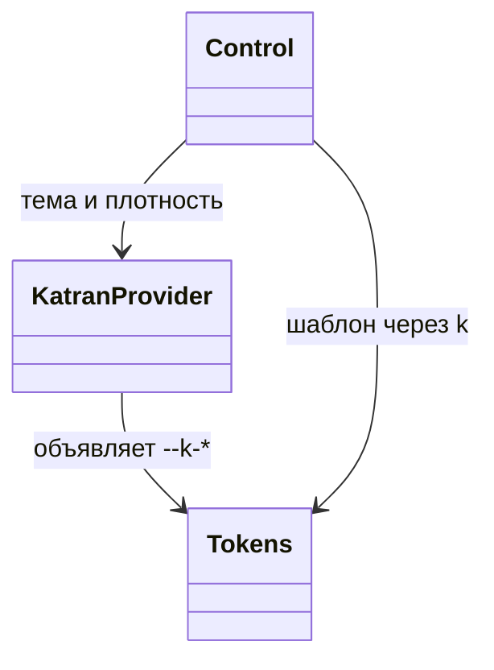
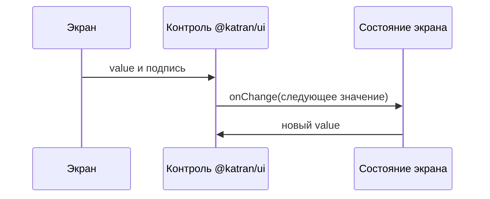

# Недостающие компоненты @katran/ui

Контроли, которых нет в публичном API `@katran/ui`. Задания лежат в папках рядом. Реализация следует стайлгайду кита [`docs/superpowers/specs/2026-10-13-katran-styled-design.md`](../../superpowers/specs/2026-10-13-katran-styled-design.md) и образцам модулей `packages/ui`.

## Стайлгайд

### Правило 1. Статические styled-компоненты

Весь кит вне горячего пути грида стилизуется styled-components 5.3.11.

- Импорт только из `packages/ui/src/styled.ts`. Прямой импорт пакета `styled-components` в модуле компонента запрещён.
- Шаблон статический: в нём нет функций от пропсов и от `theme`. Шаблон вычисляется один раз при загрузке модуля.
- Токены читаются объектом `k` из `@katran/tokens`: `${k.paper}` становится `var(--k-paper)`. Значения приходят из `packages/tokens/src/tokens.src.ts`, остальное порождает `pnpm gen`. Новый размер, слой или длительность добавляется в `tokens.src.ts` и генерируется, а не пишется числом в шаблоне.
- Состояние и вариант — атрибутами `data-*` и `aria-*`, селектор `&:where([data-size='s'])`. Так же сделаны `Button` и `Input`.
- Меняющееся число на элементе (доля шкалы, высота графика) задаётся инлайновой CSS-переменной. В шаблоне переменная читается, функция от пропа не появляется.
- Корень принимает `className` и ставит его на корневой элемент: у экрана работает `styled(Компонент)`.
- В шаблоне нет `px`, `rem` и `em`, кроме свойств рамки и обводки, которые разрешает `stylelint.config.js`. Нет hex, именованных цветов и `rgb()` / `hsl()`. Цвет и размер — токены.
- Планка CSS — Chromium 88, её проверяет существующий `check-css-target`.

### Правило 2. Горячий путь грида

`value/`, `GridRecord` и `GridSkeleton` не оборачиваются в `styled.*`. Это обычные элементы с постоянным классом `k-<часть>`. Правила — фрагмент `css` в `packages/ui/src/value/value.hot.ts` (или `grid.hot`), его вставляет шаблон корня `KatranProvider`.

Из этого набора на горячий путь попадает только [подсветка совпадения](highlighter/SPEC.md): её ставят в текст ячейки. Остальные контроли живут в форме, панели и наложении, для них достаточно правила 1.

### Поля

Образец — `packages/ui/src/input/Input.tsx`.

- Компонент контролируемый: `value` и `onChange` приходят снаружи. В ките нет react-hook-form и нет effector.
- Размер поля — `s | m | l`, по умолчанию `m`, те же высоты `h-ctl-s`, `h-ctl-m`, `h-ctl-l` и кегли, что у `Input`.
- `invalid` ставит `data-invalid` и `aria-invalid`. Рамка — токен `bad`, как у поля.
- Подпись и текст ошибки остаются снаружи, тем же способом, что у `Input`, если в контракте нет своего `label` как доступного имени.
- React 17, classic JSX. Серверный рендер не нужен.

### Контраст и плотность

Читаемый текст на фоне — не ниже 4.5, служебный знак — не ниже 3. Пороги — `packages/tokens/src/contrast.rules.ts`. Пары, которые уже проходят на `paper`, `chip`, `ok-soft`, `warn-soft`, `bad-soft` и `val-soft`, новыми цветами не заменяются.

Плотность меняет размеры через `var(--k-density)` внутри токенов. Компонент плотность не считает.

### Поставка

- Код — `packages/ui/src/<модуль>/`. Тест лежит рядом с модулем.
- Символ экспортируется из индексного файла модуля и из `packages/ui/src/index.ts`.
- Строка витрины — секция в `apps/demo`, светлая и тёмная тема.
- Новая runtime-зависимость в `@katran/ui` не добавляется. Сейчас такая зависимость одна: `@floating-ui/dom`.

## Состав

| Компонент | Модуль | Задание |
|---|---|---|
| Набор иконок | `icon/` | [icons](icons/SPEC.md) |
| Спиннер | `state/Spinner` | [spinner](spinner/SPEC.md) |
| Текст | `typography/Text` | [typography](typography/SPEC.md) |
| Очередь тостов | `state/toast` | [toast](toast/SPEC.md) |
| Поле времени | публичный `TimeField` | [time-field](time-field/SPEC.md) |
| Текстовая ссылка | `button/Link` | [text-link](text-link/SPEC.md) |
| Многострочное поле | `input/Textarea` | [textarea](textarea/SPEC.md) |
| Три состояния | `input/TripleState` | [triple-state](triple-state/SPEC.md) |
| Поле суммы | `input/AmountField` | [amount-field](amount-field/SPEC.md) |
| Диапазон суммы | `input/AmountRange` | [amount-range](amount-range/SPEC.md) |
| Диапазон числа | `input/NumberRange` | [number-range](number-range/SPEC.md) |
| Линейный график | `chart/LineChart` | [chart](chart/SPEC.md) |
| Радиокнопки | `input/RadioGroup` | [radio](radio/SPEC.md) |
| Маска ввода | `input/MaskedInput` | [masked-input](masked-input/SPEC.md) |
| Хлебные крошки | `breadcrumb/Breadcrumbs` | [breadcrumbs](breadcrumbs/SPEC.md) |
| Подсветка совпадения | `value/Highlight` | [highlighter](highlighter/SPEC.md) |
| Слайдер | `input/Slider` | [slider](slider/SPEC.md) |

Сегментный ряд подписей новым компонентом не заводится: его закрывает `Tabs` с `variant="segment"`. Решение — [switch](switch/SPEC.md).
