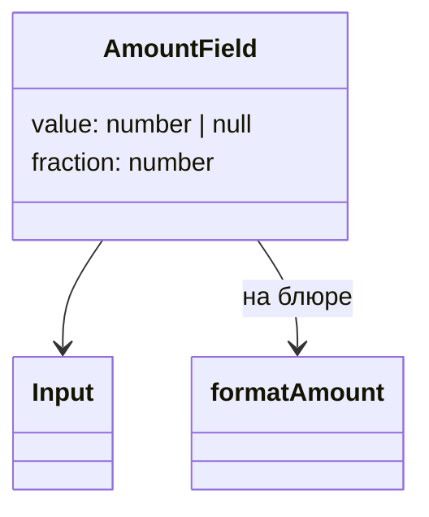
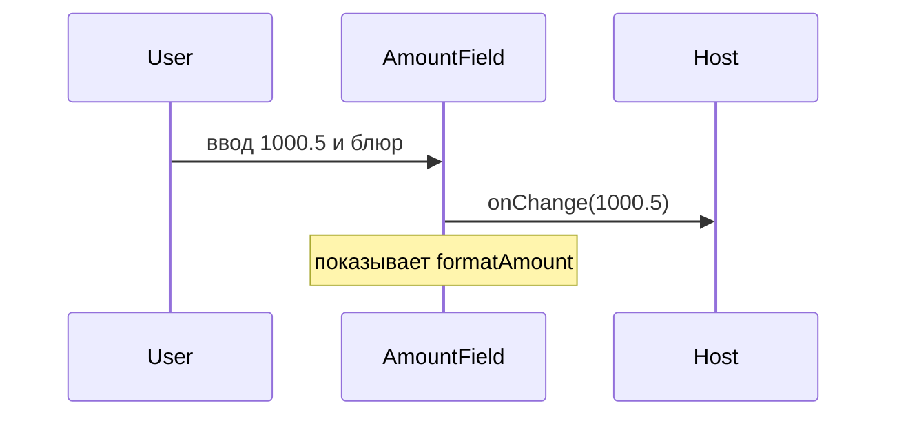

# Поле суммы

Общие правила — [стайлгайд](../README.md#стайлгайд). Им пользуется [диапазон суммы](../amount-range/SPEC.md).

## Зачем

Денежная величина вводится числом и показывается с группами разрядов. `formatAmount` в `packages/ui/src/format/amount.ts` уже превращает готовое число в строку и не проверяет ввод.

## Не цели

Не выбирать валюту и не считать комиссию. Код валюты, если он нужен, экран ставит рядом текстом. Не вводить новую маску копеек: на фокусе поле показывает сырое число, на блюре — `formatAmount`.

## Контракт

Модуль `packages/ui/src/input/AmountField.tsx`.

```ts
export type AmountFieldProps = {
  value: number | null
  onChange: (value: number | null) => void
  label: string
  fraction?: number
  size?: 's' | 'm' | 'l'
  disabled?: boolean
  invalid?: boolean
  placeholder?: string
  className?: string
}
```

`fraction` по умолчанию 2, как у `formatAmount`. Пустой ввод — `null`, не `0`. Нечисло остаётся в поле как набранный текст, наружу уходит `null`, `aria-invalid` стоит до исправления. Знак минус разрешён: в реестре суммы бывают отрицательными.

`label` — доступное имя поля. Текст в поле выровнен вправо, как суммы в колонке.

На фокусе поле показывает сырое число с точкой. На блюре валидное число показывается через `formatAmount(value, fraction)`.

## Стили

Правило 1. Оболочка — `Input` того же `size`. Своего цвета и рамки у суммы нет: их даёт поле, включая `data-invalid`. Выравнивание вправо — статическое `text-align` в шаблоне, не функция от пропа. `className` уходит на `Input`.

## Поведение





## Проверка

Тест: пусто даёт `null`, после блюра при `fraction` 2 видно «1 000.50», минус сохраняется, мусор наружу уходит как `null`. Витрина полей показывает поле рядом с диапазоном.
