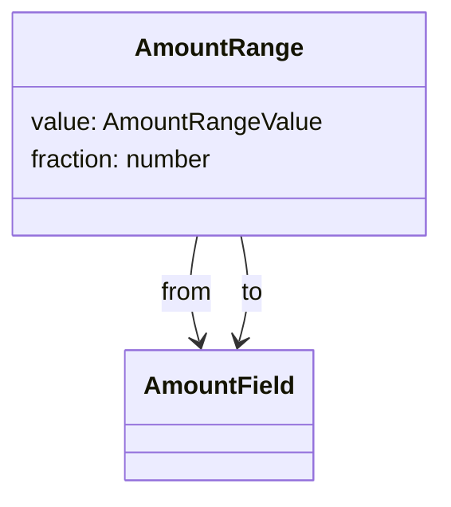
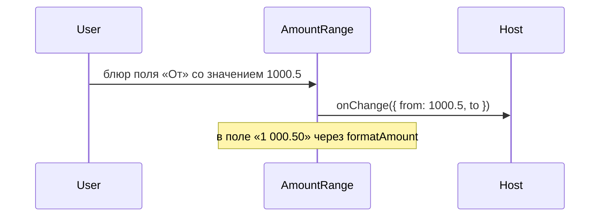

# Диапазон суммы

Общие правила — [стайлгайд](../README.md#стайлгайд). Форматирование — `formatAmount`. Одно поле — [amount-field](../amount-field/SPEC.md).

## Зачем

Фильтр суммы — пара «от» и «до», не один инпут. `formatAmount` только превращает число в строку.

## Не цели

Не вводить валюту внутри диапазона: код валюты остаётся у экрана. Не менять границы местами, если «от» больше «до».

## Контракт

Модуль `packages/ui/src/input/AmountRange.tsx`.

```ts
export type AmountBound = number | null
export type AmountRangeValue = { from: AmountBound; to: AmountBound }
export type AmountRangeProps = {
  value: AmountRangeValue
  onChange: (value: AmountRangeValue) => void
  label: string
  fraction?: number
  size?: 's' | 'm' | 'l'
  disabled?: boolean
  invalid?: boolean
  className?: string
}
```

`fraction` по умолчанию 2. Пустое поле — `null`, не `0`. `from > to` при обоих заданных ставит `invalid` на оба поля. `onChange` всё равно отдаёт ввод: правило «от не больше до» экран может принять сам.

Подписи полей внутри — «От» и «До». Общее имя группы — `label` на `role="group"`.

На фокусе поле показывает сырое число с точкой. На блюре — `formatAmount`. Отрицательные суммы разрешены.

## Стили

Правило 1. Два [поля суммы](../amount-field/SPEC.md) в ряд. Зазор — `field-gap` или `sp-2`, тот же, что у пары полей фильтра. Своей рамки у группы нет. `className` на корне группы. Размер обоих полей — один `size`.

## Поведение





## Проверка

Тест: пусто даёт `null`, мусор не становится числом и зовёт `onChange` с `null` для этой границы, `from > to` ставит `aria-invalid` и не меняет порядок границ. Витрина полей показывает пару.
