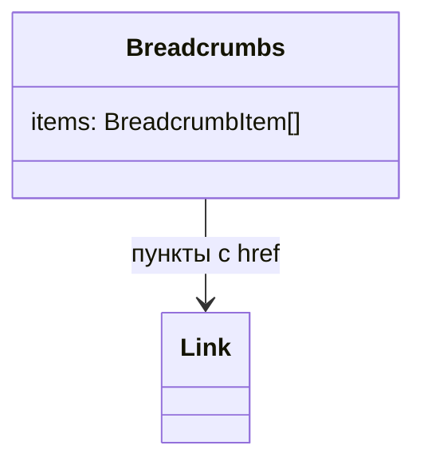
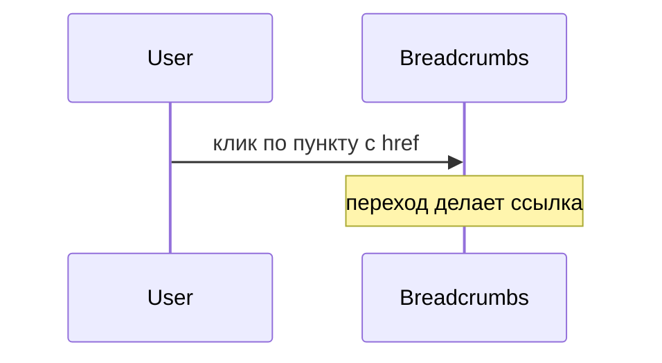

# Хлебные крошки

Общие правила — [стайлгайд](../README.md#стайлгайд). Зависит от [текстовой ссылки](../text-link/SPEC.md).

## Зачем

Оболочка `Shell` ведёт между разделами списком ссылок. Странице внутри раздела нужна цепочка «раздел / страница» в своём потоке, без второго меню.

## Не цели

Не строить крошки из роутера. Не прятать длинную цепочку в меню: все пункты видны.

## Контракт

Модуль `packages/ui/src/breadcrumb/Breadcrumbs.tsx`.

```ts
export type BreadcrumbItem = {
  label: string
  href?: string
}
export type BreadcrumbsProps = {
  items: BreadcrumbItem[]
  className?: string
}
```

Корень — `nav` с доступным именем «Навигационная цепочка». Внутри `ol`. Пункт с `href` — `Link`. Последний пункт — `aria-current="page"`. Если у последнего есть `href`, ссылка остаётся и `aria-current` тоже. Разделитель «/» цветом `muted` скрыт от доступности.

Пустой `items` не рендерит `nav`.

## Стили

Правило 1. Кегль `fs-2`, цвет текущего пункта `ink`, ссылок — как у `Link`. Зазор — `sp-1`. Разделитель не кнопка и не ссылка. `className` на `nav`.

## Поведение





## Проверка

Тест: у последнего `aria-current="page"`, разделитель скрыт, пустой список ничего не рисует. Витрина — цепочка из трёх пунктов.
