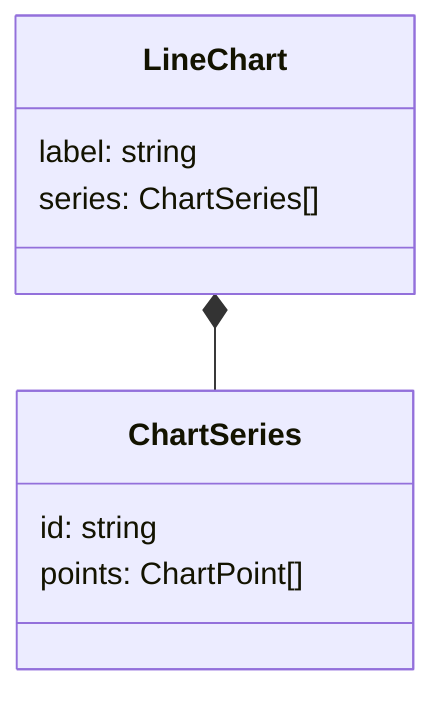
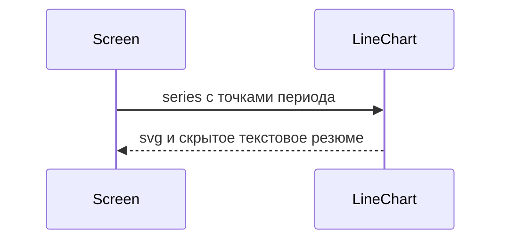

# Линейный график

Общие правила — [стайлгайд](../README.md#стайлгайд).

## Зачем

Над реестром нужен линейный график за период: несколько рядов, категории по оси X, разрыв линии на пустой точке. В ките графиков нет.

## Не цели

Не подключать библиотеку графиков. Новая runtime-зависимость в `@katran/ui` не появляется. Не рисовать круговые диаграммы, стеки и две оси. Не ходить в сеть. Снимок графика делает приложение, не кит.

## Контракт

Модуль `packages/ui/src/chart/LineChart.tsx`.

```ts
export type ChartPoint = { x: string; y: number | null }
export type ChartSeries = { id: string; label: string; points: ChartPoint[] }
export type LineChartProps = {
  label: string
  series: ChartSeries[]
  /** Подписи оси X уже отформатированы экраном. */
  height?: number
  className?: string
}
```

Ось X — категории в порядке `points`, не парсер дат. `null` разрывает линию. Ширина — 100% родителя.

Цвета серий по порядку: `val`, `ok`, `warn`, `opt`. Пятая серия снова берёт `val`. Первый срез обещает четыре различимых ряда, не отдельную палитру.

Легенда — текст `label` серии цветом линии, не ряд кнопок. Доступное имя графика — `label` на `role="img"`. Рядом, визуально скрытым текстом, резюме: минимум, максимум и подпись каждой серии. График дополняет реестр и не заменяет таблицу тех же чисел.

Сетка и оси — `line` и `muted`. Подписи оси не мельче `fs-3`.

## Стили

Правило 1. Корень — `figure` или `div` со styled-обёрткой, `className` на нём. Высота по умолчанию — токен `side`. Своя высота приходит инлайновой переменной `--k-chart-h` на корне, шаблон читает `var(--k-chart-h, ${k.side})`. Функции от `height` в шаблоне нет.

Цвета только из списка серий выше. Hex и `rgb()` не пишутся. График не стоит в горячем пути записи, правило 2 на него не распространяется.

## Поведение





## Проверка

Тест: пустые `series` дают доступный текст «Нет данных» без падения, две серии рисуют две линии, `null` не соединяет соседние точки. Витрина — отдельная секция, не страница реестра. Замер скорости грида этот компонент не проходит.
