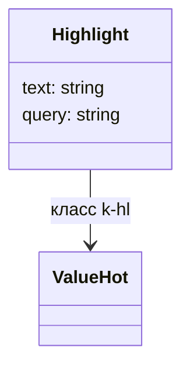
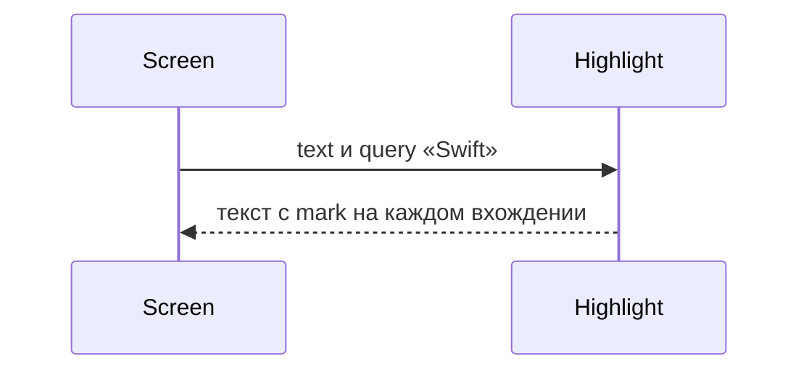

# Подсветка совпадения

Общие правила — [стайлгайд](../README.md#стайлгайд).

## Зачем

Поиск по тексту помечает совпавший фрагмент внутри строки. `Tag` и значения ячейки подстроку не ищут.

## Не цели

Не искать по выражению, которое прислал экран. Не подсвечивать больше одного запроса. Не менять регистр исходной строки.

## Контракт

Модуль `packages/ui/src/value/Highlight.tsx`. Имя экспорта `Highlight`.

```ts
export type HighlightProps = {
  text: string
  query: string
  className?: string
}
```

Пустой `query` или строка короче двух символов выводит `text` без пометок: один символ даёт слишком много совпадений в реестре. Сравнение без учёта регистра, исходные символы сохраняются. Все непересекающиеся вхождения оборачиваются в `mark`.

Спецсимволы запроса ищутся как текст.

`mark` не получает отдельной роли: родительский текст остаётся целым для копирования.

## Стили

Правило 2. Подсветка стоит в тексте ячейки, поэтому это обычный элемент, не styled-компонент. Класс `k-hl` на `mark`. Правило фона живёт во фрагменте `value.hot` рядом с остальными значениями и вставляется шаблоном корня провайдера.

Фон — `val-soft`, текст — `ink`. Пара проходит порог 4.5 в обеих темах. `className` дописывается к `k-hl` на корне, как у `Tag`.

## Поведение





## Проверка

Тест: пустой запрос без `mark`, два вхождения разного регистра, точка в запросе не становится «любой символ». Витрина значений показывает строку с двумя совпадениями. В модуле нет вызова `styled.*`: это проверяет линт горячего пути.
