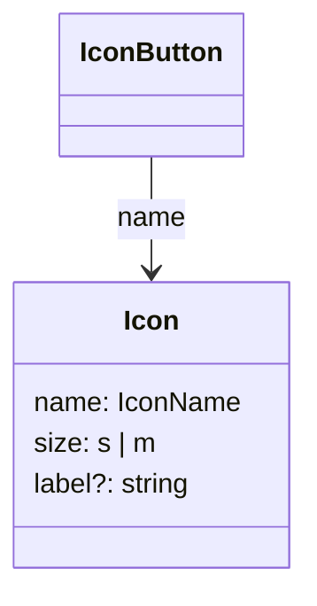
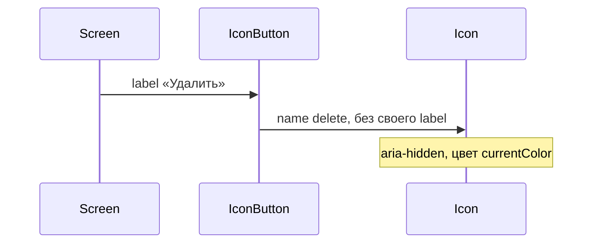

# Набор иконок

Общие правила — [стайлгайд](../README.md#стайлгайд).

## Зачем

`IconButton` и поля рисуют знак локальным svg внутри модуля. Экрану реестра и деталки нужен общий набор: одно имя, два размера, цвет текста родителя. Без него каждое действие копирует свою фигуру.

## Не цели

Не подключать шрифт-иконку и сторонний пакет. Не делать иконку кнопкой: клик и доступное имя действия остаются у `IconButton`. Не анимировать знак `loading`: вращение — у [спиннера](../spinner/SPEC.md).

## Контракт

Модуль `packages/ui/src/icon/`.

```ts
export type IconName =
  | 'plus' | 'edit' | 'delete' | 'alert' | 'error' | 'success'
  | 'clock' | 'search' | 'info' | 'doc' | 'enter' | 'drag'
  | 'arrow-up' | 'arrow-down' | 'monitoring' | 'link' | 'settings'
  | 'check' | 'refresh' | 'copy' | 'view-on' | 'show-menu'
  | 'loading' | 'stop' | 'chevron-up' | 'chevron-down'
  | 'filter' | 'cross' | 'widget' | 'clip-add'

export type IconProps = {
  name: IconName
  size?: 's' | 'm'
  label?: string
  className?: string
}
```

`size="s"` — токен `icon-s`, `m` — `icon-m`. По умолчанию `m`. Размер стоит атрибутом `data-size`, в шаблоне читается токен, не число.

Цвет фигур — `currentColor`. Если `label` задан, у svg есть `role="img"` и доступное имя. Без `label` svg скрыт (`aria-hidden`): имя даёт родительская кнопка.

Имя вне `IconName` не проходит тип. Каталог строкой с экрана не обходится.

## Стили

Правило 1. Корень — `svg` со styled-обёрткой, `className` на нём. Обводка и заливка в `currentColor`, толщина обводки — свойство рамки, ему `px` разрешён. На `ink` и `paper` знак не текст: порог 3 достаточен.

## Поведение

Иконка не хранит нажатие. `IconButton` по-прежнему может рисовать свой знак; общий набор он начинает принимать через `name`, не ломая текущий вызов с children.





## Проверка

Тест: каждое имя рендерится, `label` попадает в доступное имя, без `label` svg скрыт, `className` стоит на корне. Витрина кнопок показывает сетку имён в двух размерах на светлой и тёмной теме.
