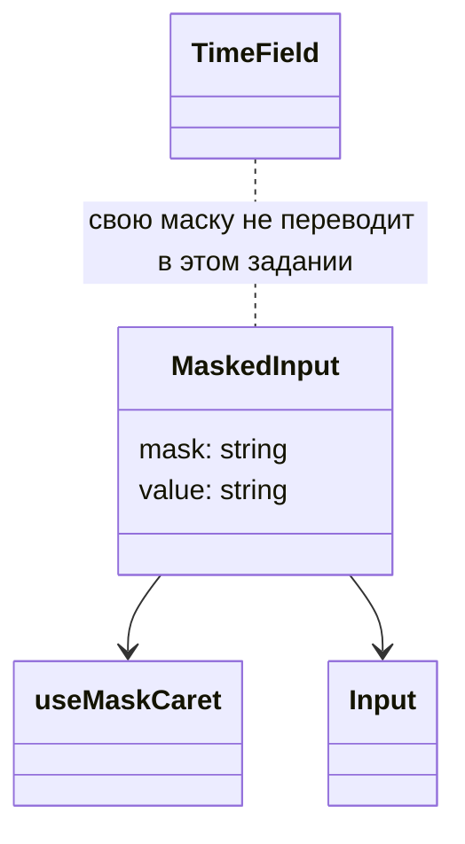
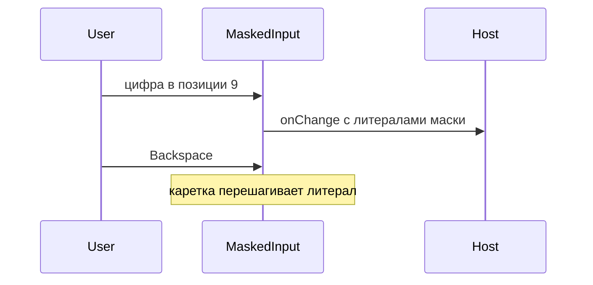

# Маска ввода

Общие правила — [стайлгайд](../README.md#стайлгайд). Время остаётся на `useMaskCaret` в [поле времени](../time-field/SPEC.md).

## Зачем

Маска даты и времени живёт внутри своих полей и наружу не отдаётся. Счёту и коду нужен тот же ввод: фиксированные позиции цифр и литералы, без копирования каретки в экран.

## Не цели

Не заменять `DateInput` и `TimeField` в этом задании. Маска — строка, не массив выражений. Произвольный символ на любую позицию не вставляется.

## Контракт

Модуль `packages/ui/src/input/MaskedInput.tsx`. Каретка переиспользует `useMaskCaret`: литералы маски пропускаются, Backspace снимает предыдущую цифру.

```ts
export type MaskedInputProps = {
  /** 9 — цифра, остальные символы — литералы. Пример: «99999 999 9 9999 9999999». */
  mask: string
  /** Строка с литералами маски, короче маски или ''. */
  value: string
  onChange: (value: string) => void
  label: string
  size?: 's' | 'm' | 'l'
  disabled?: boolean
  invalid?: boolean
  className?: string
}
```

Наружу уходит строка с литералами, не голые цифры. Незаполненный хвост пробелами не дополняется. Пока строка короче маски, `onChange` отдаёт введённый префикс. Полноту строки проверяет экран. Компонент ставит `invalid` только если его передали.

Вставка из буфера берёт цифры по порядку и раскладывает их по девяткам маски.

## Стили

Правило 1. Вид — `Input` того же `size`. Своего шаблона нет, кроме случая, когда моноширинная каретка потребует `k.mono`. Цвет и рамка остаются у поля. `className` уходит на `Input`. `label` становится доступным именем, как у `TimeField`.

## Поведение





## Проверка

Тест: литерал не стирается Backspace, вставка цифр раскладывается по маске, `label` — доступное имя. Витрина полей показывает маску счёта из примера.
