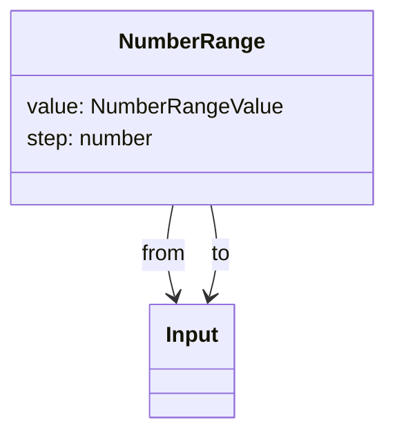
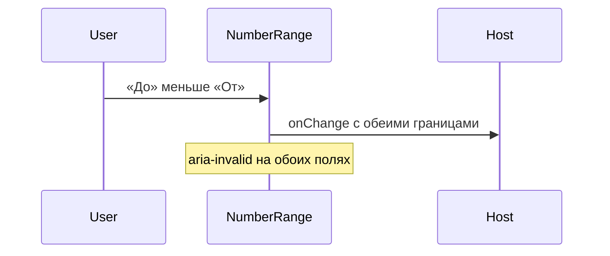

# Диапазон числа

Общие правила — [стайлгайд](../README.md#стайлгайд).

## Зачем

Фильтр «от» и «до» для целого или дробного числа, которое не является деньгами. [Поле суммы](../amount-field/SPEC.md) группирует разряды и фиксирует долю. Здесь этого нет.

## Не цели

Не форматировать через `formatAmount`. Не принимать единицы измерения. Не менять границы местами.

## Контракт

Модуль `packages/ui/src/input/NumberRange.tsx`.

```ts
export type NumberRangeValue = { from: number | null; to: number | null }
export type NumberRangeProps = {
  value: NumberRangeValue
  onChange: (value: NumberRangeValue) => void
  label: string
  step?: number
  size?: 's' | 'm' | 'l'
  disabled?: boolean
  invalid?: boolean
  className?: string
}
```

`step` по умолчанию 1. Пустое поле — `null`. Ввод с клавиатуры, не только стрелки нативного поля: стрелки остаются у `input`. `from > to` при обоих числах ставит `aria-invalid` и не меняет границы местами. Группа — `role="group"` с именем `label`. Подписи внутри — «От» и «До».

## Стили

Правило 1. Два `Input` в ряд, зазор как у [диапазона суммы](../amount-range/SPEC.md). Текст по левому краю: это не колонка денег. `className` на корне группы. Своего цвета нет.

## Поведение





## Проверка

Тест пустого `null`, шага и признака `from > to`. Витрина полей показывает диапазон рядом с суммой: у числа нет групп разрядов.
