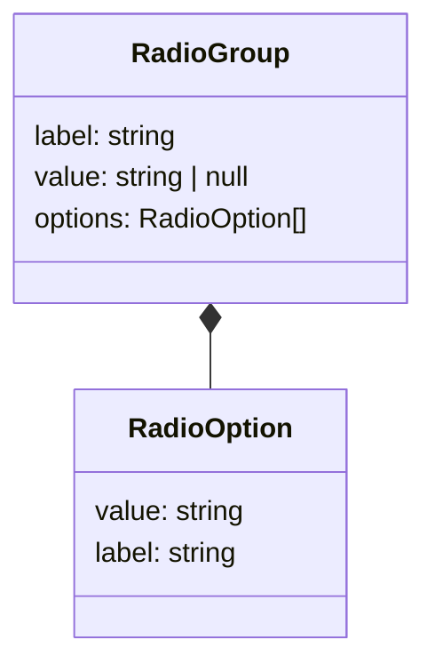
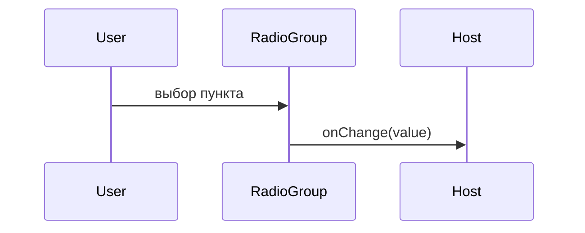

# Радиокнопки

Общие правила — [стайлгайд](../README.md#стайлгайд).

## Зачем

Один выбор из короткого списка, где все варианты видны сразу. `Select` прячет список. `Tabs` переключает вид экрана, а не значение поля.

## Не цели

Не делать карточный выбор с описанием на два абзаца. Подпись пункта — строка. Повторный клик по выбранному пункт не снимает: снятие делает экран, передав `null`, если сценарий это разрешает.

## Контракт

Модуль `packages/ui/src/input/RadioGroup.tsx`.

```ts
export type RadioOption = { value: string; label: string; disabled?: boolean }
export type RadioGroupProps = {
  label: string
  name: string
  value: string | null
  options: RadioOption[]
  onChange: (value: string) => void
  disabled?: boolean
  className?: string
}
```

Корень — `role="radiogroup"` с именем `label`. Каждый пункт — нативный `input type="radio"` с общим `name`, чтобы стрелки группы работали у браузера. Выбранный пункт один. `value={null}` — ни один не выбран.

`disabled` на группе блокирует все пункты. `disabled` пункта блокирует один.

## Стили

Правило 1. Кружок — токен `dot-m`, выбранная точка — `val`, кольцо — `line`, фокус — то же кольцо, что у `Input`. Подпись пункта — `fs-1` и `ink`. Состояние выбранности читается у нативного `:checked`, не функцией от пропа. `className` на корне группы. Зазор пунктов — `sp-2`.

## Поведение





## Проверка

Тест: одно имя у всех input, смена вызывает `onChange` один раз, пункт `disabled` не выбран кликом, у группы есть доступное имя. Витрина полей показывает группу из трёх пунктов.
