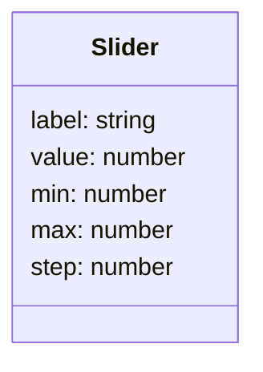
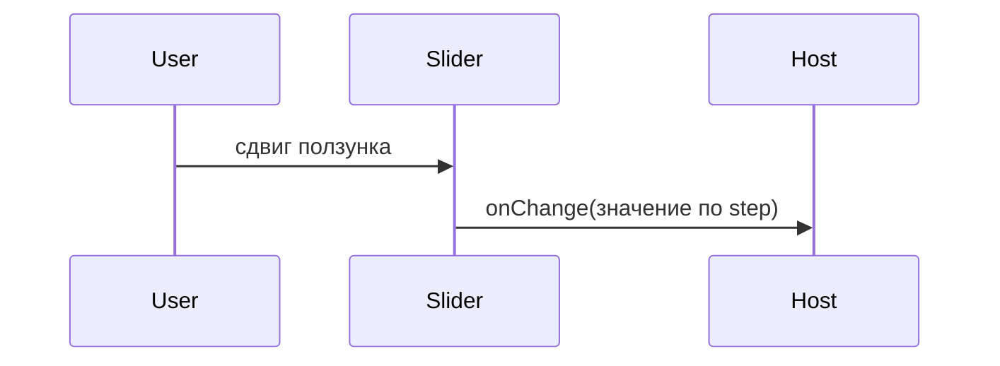

# Слайдер

Общие правила — [стайлгайд](../README.md#стайлгайд).

## Зачем

Одно число выбирается на шкале, а не набирается. В ките для числа есть только поля ввода.

## Не цели

Не делать два ползунка. Диапазон из двух чисел — [number-range](../number-range/SPEC.md). Не подписывать каждое деление, если их больше десяти: подписи у минимума, максимума и текущего значения.

## Контракт

Модуль `packages/ui/src/input/Slider.tsx`.

```ts
export type SliderProps = {
  label: string
  value: number
  onChange: (value: number) => void
  min: number
  max: number
  step?: number
  disabled?: boolean
  className?: string
}
```

`step` по умолчанию 1. Значение снаружи приводится к диапазону `min…max` с шагом. Если пришедшее число не совпало с приведённым, компонент показывает приведённое и один раз зовёт `onChange`. Дальше не зацикливается.

Элемент — `input type="range"`. Доступное имя — `label`. Текущее число написано текстом рядом, без тултипа. Клавиатура — стрелки нативного range. `disabled` не зовёт `onChange`.

## Стили

Правило 1. Дорожка — `line`, заполненная часть и ползунок — `val`. Доля заполнения — инлайновая переменная `--k-slider` на корне, шаблон читает её в градиенте или в псевдоэлементе. Функции от `value` в шаблоне нет.

Ползунок не меньше `icon-m`, чтобы принять фокус и попадание. Кольцо фокуса то же, что у `Input`. Подписи минимума и максимума — `fs-3` и `muted`. Текущее число — `fs-1` и `ink`. `className` на корне.

Сырой `px` для диаметра не пишется. Если нативный бегунок нельзя окрасить токеном без функции, окраска остаётся на дорожке, а бегунок берёт `val` статическим правилом.

## Поведение





## Проверка

Тест: значение вне диапазона приводится к границе, шаг соблюдается, у поля есть имя `label`, `disabled` блокирует ввод. Витрина полей показывает шкалу от 0 до 100.
