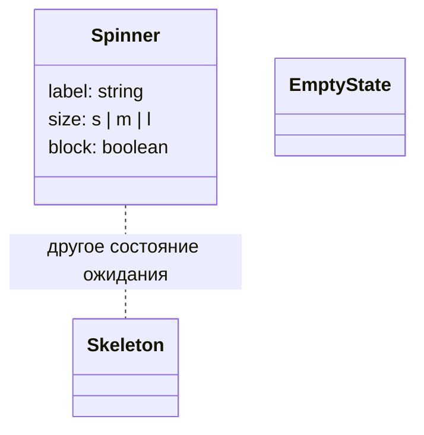
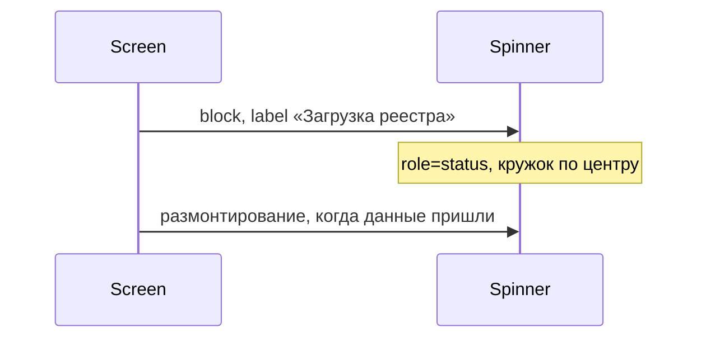

# Спиннер

Общие правила — [стайлгайд](../README.md#стайлгайд).

## Зачем

`Skeleton` занимает место будущего текста полосами. `EmptyState` объясняет, что данных нет. Экрану, который ждёт ответ и держит блок известной высоты, нужен кружок по центру. Кнопке подтверждения нужен тот же кружок вместо подписи.

## Не цели

Не заменяет `Skeleton`, `EmptyState` и `useLoadingGate`. Не открывает портал и не блокирует страницу сам: оверлей включает экран.

## Контракт

Модуль `packages/ui/src/state/Spinner.tsx`, экспорт рядом со `Skeleton`.

```ts
export type SpinnerProps = {
  /** Доступное имя. По умолчанию «Загрузка». */
  label?: string
  size?: 's' | 'm' | 'l'
  /** Занять родителя и выровнять кружок по центру. */
  block?: boolean
  className?: string
}
```

Диаметр из токенов, атрибут `data-size`:

| size | токен |
|---|---|
| s | `icon-s` |
| m | `icon-m` |
| l | `sp-8` |

Роль `status`, имя из `label`. `prefers-reduced-motion: reduce` останавливает вращение, имя остаётся.

`block` центрирует кружок флексом внутри переданной высоты. Высоту родителя спиннер не назначает. Пустое состояние по-прежнему рисует `EmptyState`.

## Стили

Правило 1. Цвет дуги — `val` на прозрачном треке `line`. Толщина дуги — рамка, `px` здесь разрешён. Оборот задаётся keyframes из `styled.ts`. Длительности `durations` (120 и 200 мс) для полного оборота коротки: в `tokens.src.ts` добавляется `durations.spin`, значение 800, затем `pnpm gen`. В шаблоне читается `${k.tSpin}`, число 800 в модуле не пишется.

## Поведение

Кружок крутится, пока компонент смонтирован.





## Проверка

Тест: имя по умолчанию и своё, `block` центрирует, при `prefers-reduced-motion` анимация выключена. Витрина состояний показывает три размера и блок на высоте панели, в обеих темах.
