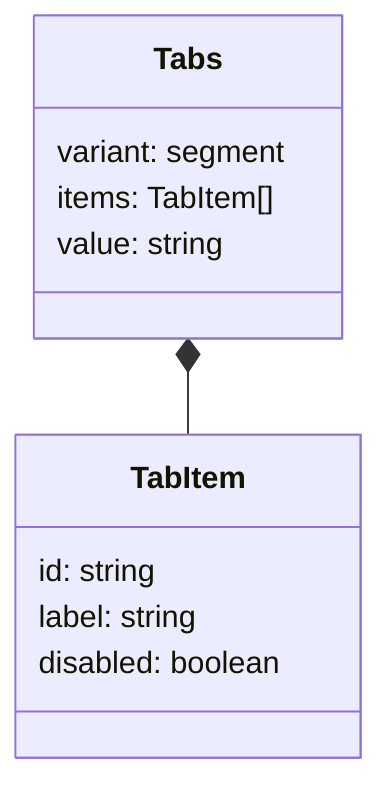
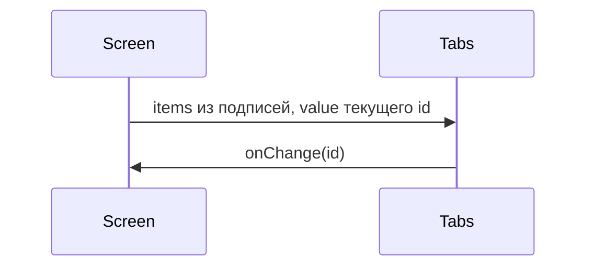

# Сегментный выбор

Общие правила — [стайлгайд](../README.md#стайлгайд).

## Решение

Новый компонент не добавляется.

Ряд коротких подписей с одним активным пунктом уже есть: `Tabs` с `variant="segment"` (значение по умолчанию). Второй контроль с тем же смыслом разойдётся со стайлгайдом кита: один вид на одну задачу, стили полосы уже собраны атрибутом `data-view`.

Соответствие экрана и `Tabs`:

| Задача экрана | Проп `Tabs` |
|---|---|
| Подписи пунктов | `items` с `id` и `label` |
| Активный пункт | `value`, равный `id` |
| Смена пункта | `onChange(id)` |
| Недоступный пункт | `TabItem.disabled` |
| Вся группа недоступна | все пункты `disabled`, либо поле не рендерят |
| Доступное имя | `label` |

Индекс пункта экран не хранит: идентификатор стабилен при смене порядка.

Булев переключатель (`role="switch"`) в этот набор не входит. Два положения с подписью закрывает `Checkbox`.

## Поведение

## Проверка

Новых тестов кита нет. Сегментный вид уже на витрине вкладок. Экран собирает `items` из своих подписей и хранит `id`.
