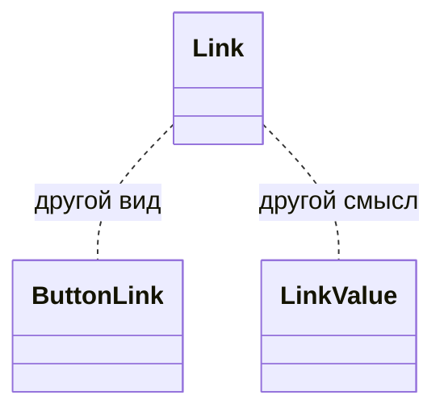

# Текстовая ссылка

Общие правила — [стайлгайд](../README.md#стайлгайд).

## Зачем

`ButtonLink` — это `Button` на теге `a`: высота контроля, фон, рамка. `LinkValue` показывает значение поля и умеет копировать. Переход по тексту в абзаце и в ячейке вне горячего пути — обычная ссылка цвета `val`, без кнопки.

## Не цели

Не менять вид `ButtonLink`. Не заменять `LinkValue`. Не добавлять к адресу фразу «откроется в новой вкладке»: это пишет экран, если адрес внешний и это важно.

## Контракт

Модуль `packages/ui/src/button/Link.tsx`. Имя экспорта `Link`.

```ts
export type LinkProps = AnchorHTMLAttributes<HTMLAnchorElement> & {
  children: ReactNode
  className?: string
}
```

Цвет `val`, подчёркивание в покое выключено, на hover и `:focus-visible` включено. Кольцо фокуса то же, что у кнопки. `target="_blank"` без `rel` дополняется `noopener noreferrer`. Уже переданный `rel` не затирается: недостающие жетоны дописываются.

## Стили

Правило 1. Один styled-корень `a`, `className` на нём. Цвет `val` на `paper` уже в правилах контраста. Размер шрифта не фиксируется: ссылка наследует кегль родителя, в том числе `Text`. Свой `fs-*` ей не задаётся, чтобы не спорить с абзацем.

Подчёркивание — `text-decoration`. Если нужна толщина, свойство `text-decoration-thickness` допускает `px` по `stylelint.config.js`.

## Поведение



```mermaid
sequenceDiagram
  participant User
  participant Link
  User->>Link: клик по тексту
  Link-->>User: переход по href
```

## Проверка

Тест: рендерится `a`, `target="_blank"` получает `rel` с `noopener`, свой `rel` не затирается, `className` на корне. Витрина кнопок показывает `Link` рядом с `ButtonLink`.
