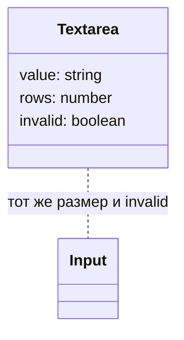
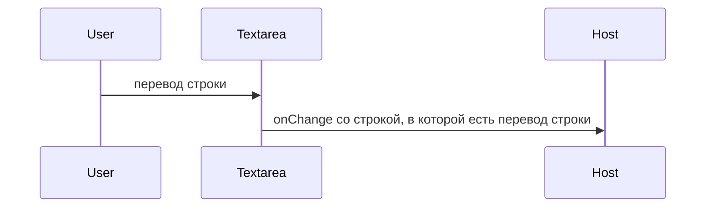

# Многострочное поле

Общие правила — [стайлгайд](../README.md#стайлгайд).

## Зачем

`Input` рендерит `input` и не принимает несколько строк. Комментарий, причина и текст сообщения вводятся абзацем.

## Не цели

Не подключать react-hook-form. Не делать редактор разметки. Авторост по содержимому не входит в первый срез: высота задаётся `rows`.

## Контракт

Модуль `packages/ui/src/input/Textarea.tsx`.

```ts
export type TextareaProps = Omit<TextareaHTMLAttributes<HTMLTextAreaElement>, 'size'> & {
  size?: 's' | 'm' | 'l'
  invalid?: boolean
  rows?: number
  className?: string
}
```

`rows` по умолчанию 3. Кегль и внутренние отступы совпадают с `Input` того же `size`. `invalid` ставит `aria-invalid` и `data-invalid`. Подпись и текст ошибки снаружи, тем же способом, что у `Input`.

Перенос строк сохраняется. Пользователь может тянуть поле по вертикали: `resize: vertical` — статическое свойство шаблона.

## Стили

Правило 1. Образец рамки, фона и фокуса — части `Input` (`FieldBox` / поле). Если textarea не встаёт в ту же рамку без функции в шаблоне, у неё свой styled-корень с теми же токенами: `paper`, `line`, `bad`, `r-m`, `fs-1` или `fs-2` по `data-size`, высоты строки из `lh-1`. Сырой `px` для высоты не пишется: высота растёт от `rows` и кегля.

## Поведение





## Проверка

Тест: тег `textarea`, `invalid` даёт `aria-invalid`, ввод из нескольких строк доходит до `onChange`. Витрина полей показывает обычное и невалидное поле обоих размеров `s` и `m`.
