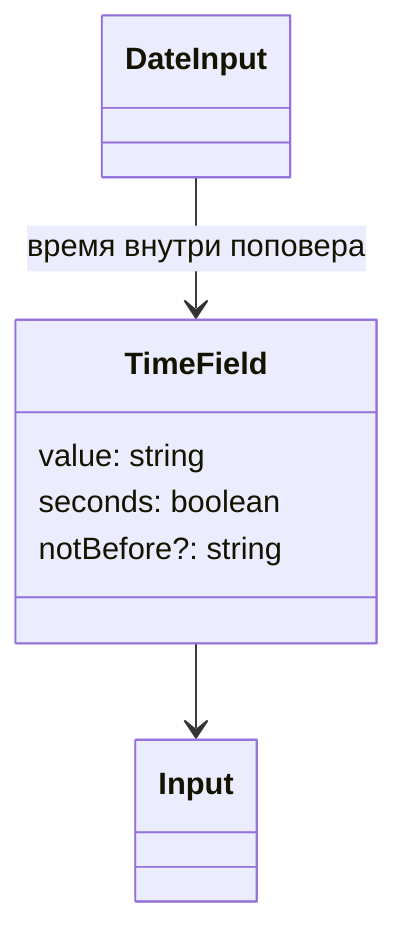
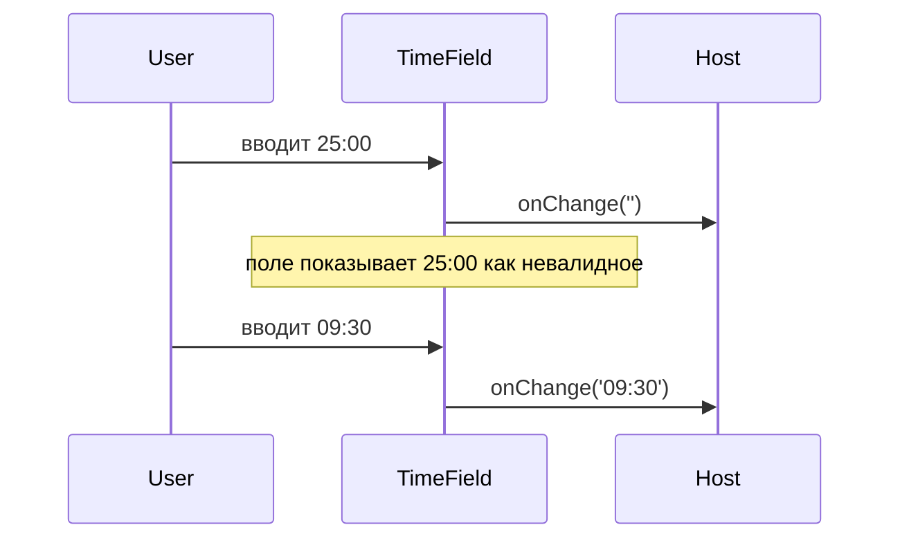

# Поле времени

Общие правила — [стайлгайд](../README.md#стайлгайд).

## Зачем

`DateInput` умеет время только вместе с днём. Фильтру и форме нужно отдельное «чч:мм» и «чч:мм:сс». `TimeField` уже реализован в `packages/ui/src/date/TimeField.tsx` для поповера календаря и не экспортируется из `packages/ui/src/date/index.ts`.

## Не цели

Не переписывать маску даты. Не собирать дату и время в одном новом поле: это по-прежнему `DateInput` с `time`. Секунды в поповере календаря не появляются, пока вызывающий код их не попросил.

## Контракт

Тип и компонент выходят в публичный `packages/ui/src/date/index.ts` и в `packages/ui/src/index.ts`.

```ts
export type TimeFieldProps = {
  /** «чч:мм», «чч:мм:сс» или ''. */
  value: string
  onChange: (value: string) => void
  /** Доступное имя. */
  label: string
  seconds?: boolean
  size?: 's' | 'm' | 'l'
  disabled?: boolean
  /** Не раньше этого времени. Невалидный ввод уходит наружу как ''. */
  notBefore?: string
  onEnter?: () => void
  className?: string
}
```

По умолчанию `seconds` выключены, маска `99:99`. С `seconds` маска `99:99:99`, секунды 00–59. Часы 00–23, минуты 00–59. Неполная строка наружу не уходит: `onChange('')`, в поле остаётся набранное, как у внутреннего `TimeField` сейчас.

`notBefore` сравнивает строки одинаковой длины. Смешение «чч:мм» и «чч:мм:сс» в одной паре — ошибка вызывающего кода. Компонент трактует формат по своему `seconds`.

`size` прокидывается в `Input`. По умолчанию остаётся `s`, как в поповере календаря.

## Стили

Своего шаблона у поля нет: вид целиком у `Input` (правило 1, атрибут `data-size`, рамка `bad` при `invalid`). `className` уходит на `Input`. Каретка остаётся на `useMaskCaret` из `MaskedDateField`. [Маска ввода](../masked-input/SPEC.md) этот компонент не ждёт.

## Поведение





## Проверка

Существующие тесты даты не ломаются. Новые: секунды, отказ часов 24, `notBefore`, публичный импорт из `@katran/ui`. Витрина полей показывает оба формата.
