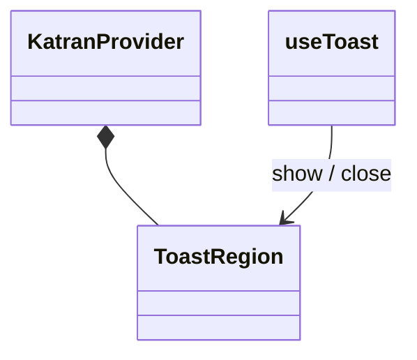
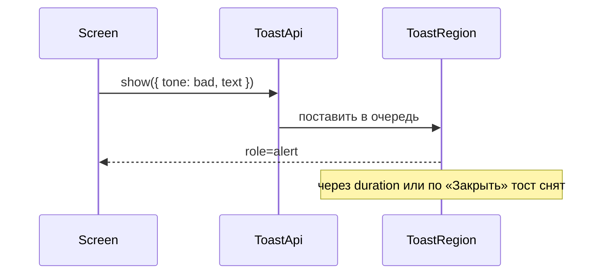

# Очередь тостов

Общие правила — [стайлгайд](../README.md#стайлгайд).

## Зачем

`Banner` стоит в потоке страницы, пока его не закроют, и второе сообщение в очередь не ставит. Копирование, ошибка запроса и итог команды должны всплыть и исчезнуть, не сдвигая реестр.

## Не цели

Не заменять `Banner` в деталке и аннулировании. Не тянуть effector в `@katran/ui`: очередь живёт в контексте провайдера. Не показывать больше четырёх тостов сразу.

## Контракт

Модуль `packages/ui/src/state/toast.tsx`. `KatranProvider` монтирует регион тостов в конце своего дерева, внутри корня, чтобы портал не искал `--k-*` снаружи.

```ts
export type ToastTone = 'neutral' | 'ok' | 'warn' | 'bad'
export type ToastInput = {
  tone?: ToastTone
  text: string
  /** Миллисекунды. По умолчанию 4000. 0 — пока не закроют. */
  duration?: number
}
export type ToastApi = {
  show: (input: ToastInput) => void
  close: (id: string) => void
}
```

Тона совпадают с `BannerTone`. Хук `useToast(): ToastApi` вне `KatranProvider` бросает понятную ошибку.

Тост — `role="status"` для `neutral` и `ok`, `role="alert"` для `warn` и `bad`. У каждого есть кнопка «Закрыть», тот же доступный шаблон, что у крестика `Banner`. Регион — `aria-live="polite"`. Тост `bad` сам `assertive`.

Новый тост встаёт под предыдущим, у верхнего края вьюпорта справа. Слой — новый токен `z.toast` со значением 250 в `tokens.src.ts` (между `menu` 200 и `tooltip` 300), затем `pnpm gen`. В шаблоне читается `${k.zToast}`. Число 250 в модуле не пишется.

По истечении `duration` тост закрывается. Наведение паузу не делает: у клавиатуры её нет. `prefers-reduced-motion` убирает сдвиг, появление остаётся мгновенным.

## Стили

Правило 1. Подложка и левая полоса тона повторяют пары `Banner`: `chip` / `ok-soft` / `warn-soft` / `bad-soft`, текст `ink2`. Эти пары уже проходят 4.5. Радиус `r-m`, тень — готовый токен тени провайдера, своя `rgba` не пишется. Отступ между тостами — `sp-2`.

## Поведение





## Проверка

Тест: два `show` дают два тоста, пятый не появляется, пока один не закрыт, `bad` имеет `alert`, крестик снимает один, вне провайдера хук падает. Витрина состояний шлёт четыре тона.
