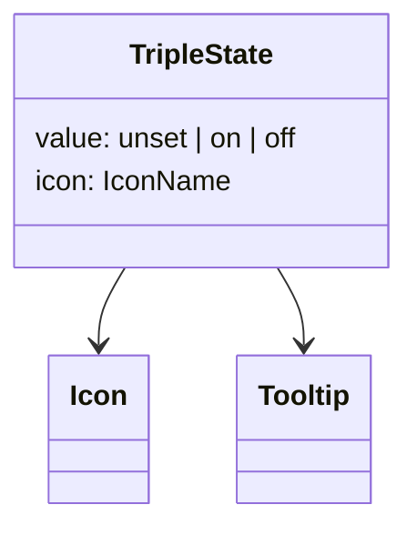
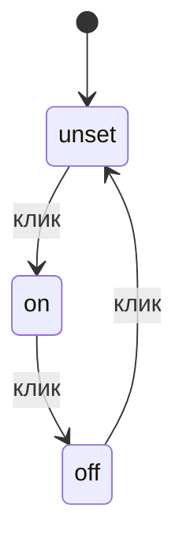
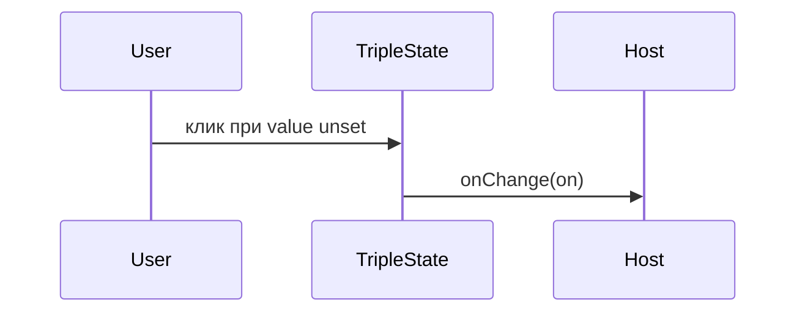

# Три состояния

Общие правила — [стайлгайд](../README.md#стайлгайд). Зависит от [иконок](../icons/SPEC.md).

## Зачем

Фильтр крутит одно поле по трём положениям: не задано, включено, выключено. Иконка и подсказка меняются. `Checkbox` знает два положения. `Tabs` для знака в узкой ячейке фильтра тяжёл.

## Не цели

Не принимать цвет положения с экрана. Не ставить три разные иконки: знак один, положение читается тоном и подсказкой.

## Контракт

Модуль `packages/ui/src/input/TripleState.tsx`.

```ts
export type TripleStateValue = 'unset' | 'on' | 'off'
export type TripleStateProps = {
  value: TripleStateValue
  onChange: (value: TripleStateValue) => void
  icon: IconName
  label: string
  hints: { unset: string; on: string; off: string }
  disabled?: boolean
  className?: string
}
```

Клик, Space и Enter идут по кругу `unset → on → off → unset`. `onChange` получает следующее положение, не событие. Три состояния не выражаются `aria-pressed`. Доступное имя — `label`. Текущее положение — текст `hints` в `aria-describedby`. Тултип — `Tooltip` с тем же текстом.

Положение стоит атрибутом `data-state`. Тон не приходит пропом.

## Стили

Правило 1. Корень — кнопка размера `IconButton` (`h-ctl-s` или `h-ctl-m` по атрибуту, по умолчанию `m`). Фон и цвет знака:

| state | фон | цвет знака |
|---|---|---|
| unset | `chip` | `muted` |
| on | `ok-soft` | `ok` |
| off | `bad-soft` | `bad` |

Текст подсказки на этих фонах проходит 4.5 там, где это текст. Знак иконки допускается от 3. `disabled` гасит кнопку так же, как `IconButton`. `className` на корне.

## Поведение







## Проверка

Тест цикла из трёх кликов, клавиша Space, `disabled` не зовёт `onChange`, `data-state` совпадает со значением. Витрина полей показывает три положения в обеих темах.
