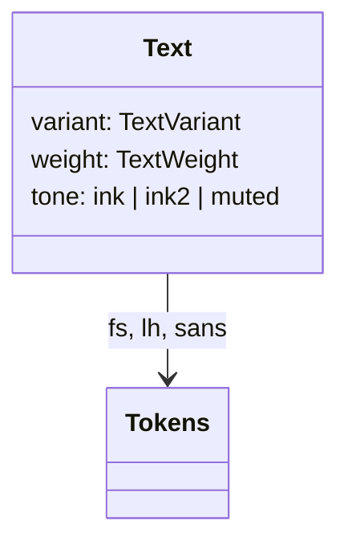
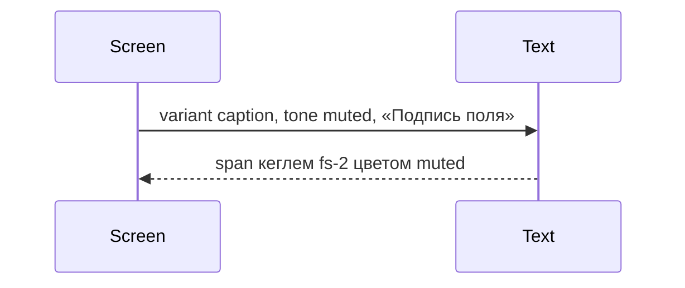

# Текст

Общие правила — [стайлгайд](../README.md#стайлгайд).

## Зачем

Кегли, интерлиньяж и семейство уже заданы токенами `k`. Экраны деталки и оболочки собирают ту же запись `font` в каждом модуле заново. `Text` собирает роли текста один раз и не вводит вторую шкалу.

## Не цели

Не добавлять кегль в `tokens.src.ts`. Не заменять заголовок страницы, если у экрана он уже свой. Не читать `theme` в шаблоне. Не обрезать строку и не ставить тултип: обрезка остаётся у значения ячейки.

## Контракт

Модуль `packages/ui/src/typography/Text.tsx`.

```ts
export type TextVariant = 'body' | 'subhead' | 'caption' | 'meta' | 'inline'
export type TextWeight = 'regular' | 'medium' | 'bold'
export type TextProps = {
  variant?: TextVariant
  weight?: TextWeight
  tone?: 'ink' | 'ink2' | 'muted'
  as?: 'p' | 'span' | 'h2' | 'div'
  className?: string
  children: ReactNode
}
```

| variant | токены | элемент по умолчанию | вес по умолчанию |
|---|---|---|---|
| body | `fs-1` / `lh-1` | `p` | regular |
| subhead | `fs-h2` / `lh-1` | `h2` | medium |
| caption | `fs-2` / `lh-2` | `span` | regular |
| meta | `fs-3` / `lh-3` | `span` | regular |
| inline | `fs-1` / `lh-1` | `span` | regular |

`tone` красит в `ink`, `ink2` или `muted` атрибутом `data-tone`. Вес — атрибутом `data-weight`. Семейство — `k.sans`.

Вложенный `Text` внутри `p` рендерится `span`, чтобы абзац не оказался внутри абзаца.

## Стили

Правило 1. Один styled-корень, вариант через `data-variant`. Цвета текста уже проходят порог 4.5 на `paper` в обеих темах, новые пары не вводятся. `className` на корне.

## Поведение





## Проверка

Тест проверяет элемент по variant, атрибуты тона и веса и то, что вложенный `Text` в `body` — `span`. Витрина токенов показывает пять вариантов на светлой и тёмной теме.
